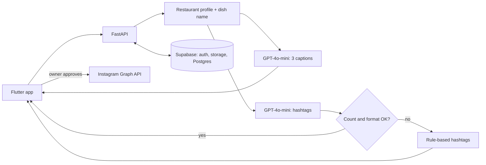

# AI Restaurant Posts

**A restaurant owner takes a photo of a dish and posts it to Instagram with a caption, without having to write one.**

> Case study · Early 2026 · Source private

*Demo run with a sample restaurant, posted to my company's test account: pick one of three captions, edit it, publish, and the post appears on Instagram.*

**Full demo (56 seconds):** set up the restaurant once → take a photo → name the dish → choose and edit a caption → post.

https://github.com/user-attachments/assets/71a29c45-fa2f-4b73-bed0-0a037bb069b3

## Purpose

**Hypothesis:** small restaurant owners don't post because they don't know what to write, not because they're short of time. Remove the writing and they'll post.

The design test was the "Tony Test": could a 58-year-old pizza shop owner post in under 60 seconds without asking his daughter for help? So the app asks for the minimum (a photo and the dish name) and does the rest.

## What it does

1. **The owner** sets up the restaurant once: name, cuisine, address.
2. **The owner** takes a photo and names the dish.
3. **The app** writes three captions in different tones, plus hashtags for the dish and the neighbourhood.
4. **The owner** picks one, edits it if they want, and posts it straight to Instagram.

## Architecture

The approach, in five decisions:

- **The model writes the style; the owner owns the facts.** Selling words like "crispy" or "perfect for a cold night" are the model's job. Prices, hours, ingredients and offers come only from what the owner entered, and the prompt forbids inventing them.
- **Nothing posts without the owner.** Every caption is shown and editable before it goes out. The model suggests and the owner publishes.
- **Code checks the model's hashtags.** Wrong count or format falls back to rule-based tags. If the caption call fails, the owner still gets three plain captions built from the facts.
- **Prompts are versioned files, not strings in code.** Each prompt is a YAML file with its model, temperature and a changelog, and tests load and check them. The caption prompt went through four versions in under three weeks.
- **Publishing waits for Instagram.** Instagram takes a moment to process an uploaded image, so publishing is two steps (create, then publish) with retries in between.

| Part | Choice |
|---|---|
| App | Flutter, Riverpod |
| Backend | FastAPI (Python) |
| Model | GPT-4o-mini, about $0.0001 per set of captions, about 3 seconds |
| Data | Supabase (auth, image storage, Postgres) |
| Posting | Instagram Graph API |

## Outcome

| Metric | What it tests | Result |
|---|---|---|
| Owners who post in under 60 seconds without help | The Tony Test | Pending |
| Captions posted unedited or lightly edited | Whether the writing is good enough to remove the blocker | Pending |
| Posts per restaurant per week | Whether removing the writing changes how often they post | Pending |

## What I learned

- **Sell the barrier you remove, not the seconds you save.** I started with "post in 30 seconds". Owners don't feel short of time; they feel they don't know how. The pitch changed to "post without a designer or copywriter".
- **Pick the right bar for "hallucination".** My first test counted every word the owner hadn't supplied, like "creamy" or "authentic". Across 30 dishes, small local models failed it 126 to 135 times (Llama 3 8B, Gemma 3 1B). But zero embellishment is the wrong goal for marketing copy: it should sell. The line that matters is facts. A made-up price or a "20% off" the owner never offered is a real problem; "delightful" is not.
- **Keep a person on anything that makes a promise.** No prompt guarantees the model never invents an offer, so the owner sees and can edit every caption before it posts. In the demo, the owner adds "Deals today!" themselves.
- **Hashtags need context.** A fixed lookup table gave generic tags like #Yum. Letting the model choose from the restaurant's street, city and cuisine plus a curated pool, with a code check and a fallback, gave tags specific to the place.
- **Plan manual, then automate.** The first plan was copy-paste into Instagram, to ship faster. Direct posting replaced it once the core flow worked.

---

More about me at [shrikantvarma.com](https://shrikantvarma.com).
